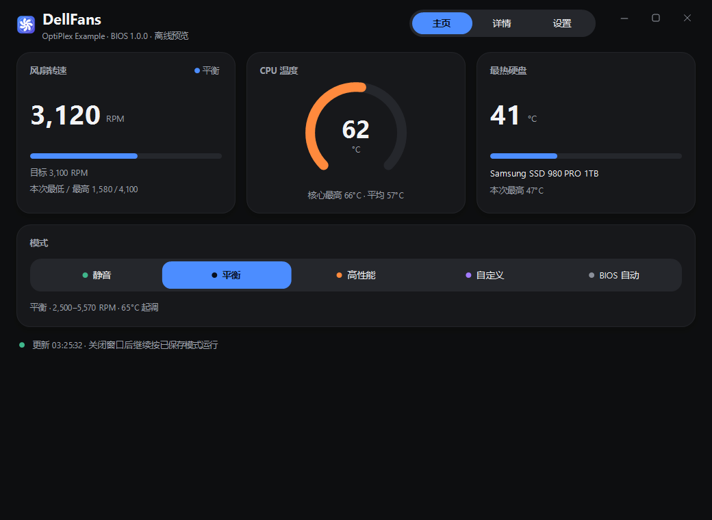
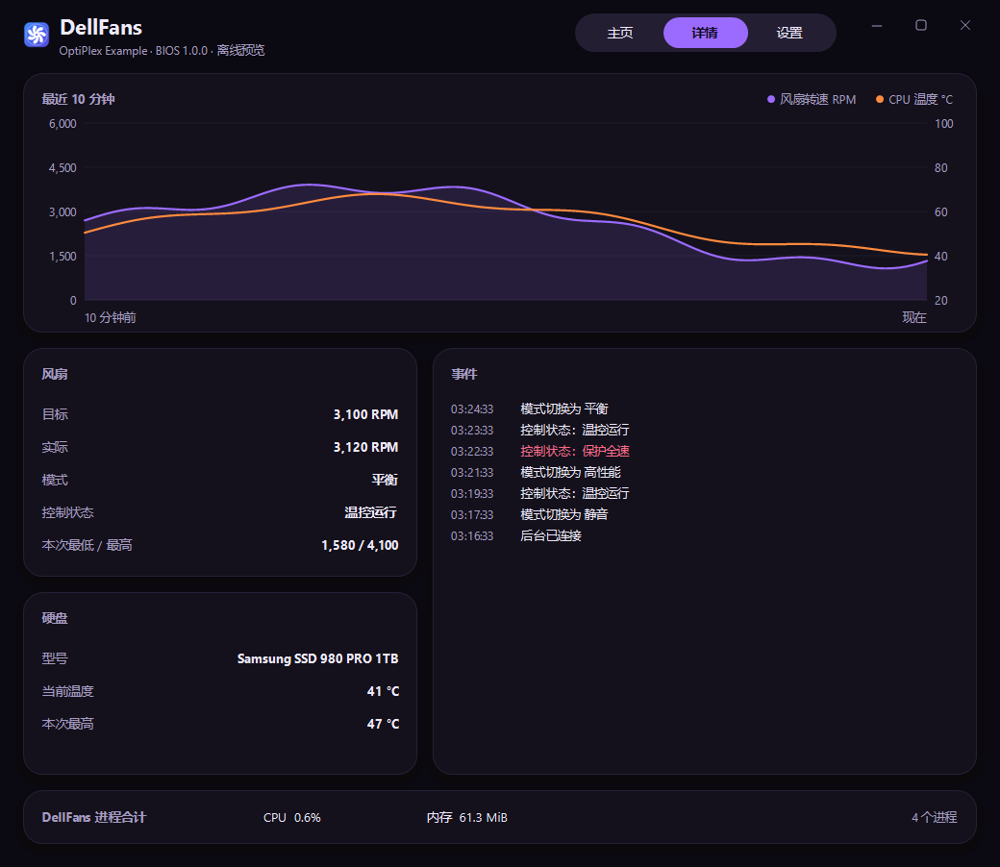
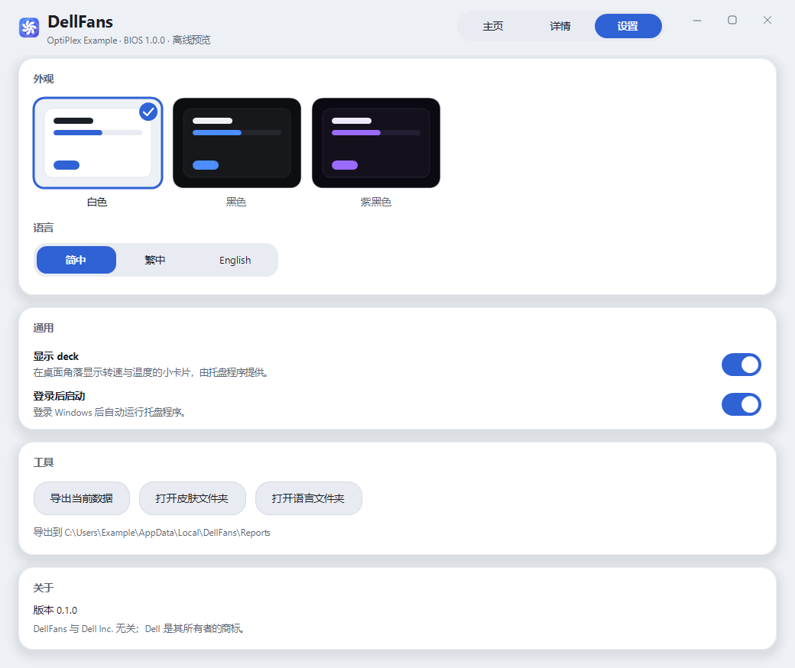
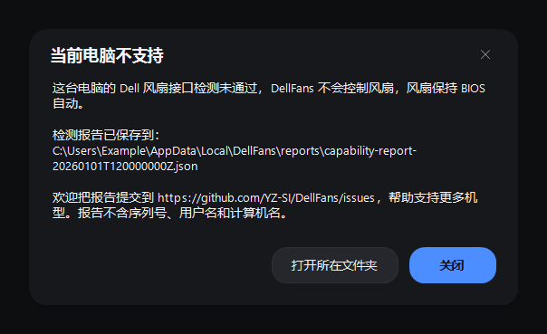
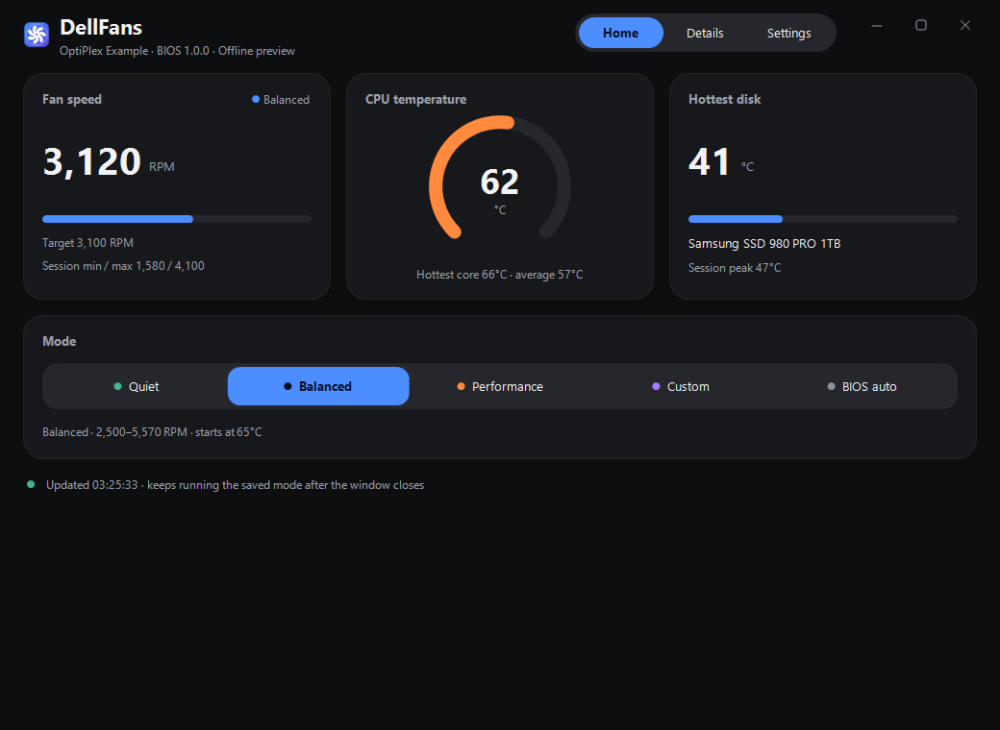
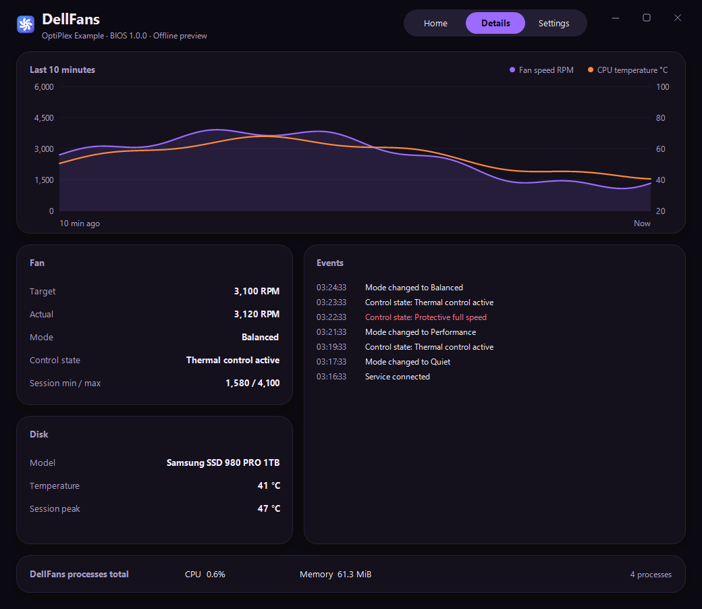
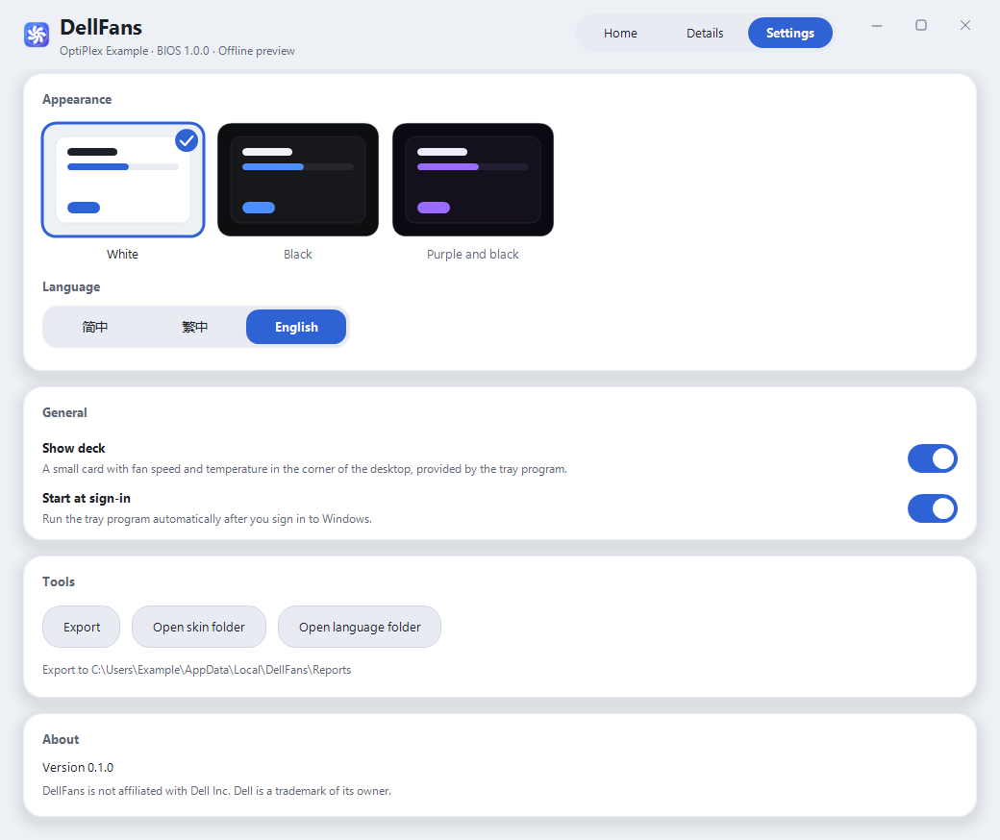

# DellFans 0.1.0

**简体中文** | [English](#english)

DellFans 是 Windows 上的 Dell 电脑风扇控制工具：用静音／平衡／高性能／自定义四种模式按 CPU 温度调节风扇，随时可以一键交回 BIOS 自动控制。
**绿色版，无需安装**：解压后双击 `DellFans.exe` 即可使用。常驻的控速程序、监护和托盘三个进程合计约 30 MiB 私有内存（实测）。

> **硬件风险。** 本程序通过 Dell WMI／SMM 接口写入风扇固件设置。每台电脑在第一次使用前都要先通过接口检测，未通过时不会控制风扇。
> 使用风险自负，不提供任何担保（见许可证）。DellFans 与 Dell Inc. 无关；Dell 是其所有者的商标。

| 主页（黑色） | 详情（紫黑） | 设置（白色） |
|---|---|---|
|  |  |  |

| 首次检测 | 当前电脑不支持 | 交回 BIOS 确认 |
|---|---|---|
|  |  |  |

截图为离线渲染（`DellFans.exe --render-preview`），读数为示例数据。

## 下载与使用

1. 从 [Releases](https://github.com/YZ-SI/DellFans/releases) 下载 `DellFans-0.1.0-win-x64.zip`，解压到本地文件夹（需要 Windows 10 x64 与 .NET Framework 4.8）。
2. 双击 `DellFans.exe`。第一次运行会请求管理员权限（UAC），用来启动后台控速程序；**不会安装任何服务，也不会复制文件到其他位置**。
3. 第一次打开窗口时会检测这台电脑的 Dell 风扇接口（见下文）。通过后按**平衡模式**开始控速，可随时切换模式。
4. 关闭窗口后，托盘和控速程序继续运行。托盘菜单的 **“退出 DellFans”** 会先把风扇交回 BIOS 自动，再退出全部程序。
5. 设置页或托盘菜单可开启 **“登录后启动”**：登录后托盘自动启动，并请求一次管理员权限来启动控速程序。
6. 不再使用：从托盘退出，关闭“登录后启动”，删除解压的文件夹即可。设置和检测记录保存在 `%ProgramData%\DellFans`，需要时可一并删除。

控速程序意外退出时，监护进程会把风扇交回 BIOS，托盘随后请求重新启动它。

## 组成

| 程序 | 语言 | 权限 | 作用 |
|---|---|---|---|
| `DellFans.Service.exe --portable` | C# (.NET Framework 4.8) | 管理员（后台进程，不是 Windows 服务） | 读传感器、按模式控速、写 SMM／BIOS、本地管道服务端、接口检测 |
| `DellFans.Watchdog.exe` | Rust | 由控速程序启动 | 控速程序失效时把风扇交回 BIOS |
| `DellFans.Tray.exe` | Rust | 当前用户 | 托盘图标与菜单、桌面浮窗（deck）、模式快捷切换、登录后启动 |
| `DellFans.exe` | C# WinForms | 当前用户（不提权） | 主页、详情、设置；关闭窗口即退出进程 |
| `DellFans.Cli.exe` | C# | 当前用户 | 命令行工具 |

浮窗平时是一个小胶囊（转速与温度）；鼠标停留 0.3 秒或单击后展开，可切换模式、打开主界面；右上角图钉可固定展开。按住任意位置可拖动。

## 支持的电脑与首次检测

DellFans 面向提供 Dell WMI／SMM 风扇接口的 Dell 电脑。是否可用由检测决定，不按机型名单判断（详见 [docs/CAPABILITY.md](docs/CAPABILITY.md)）：

1. 控速程序自动做**只读检查**：Dell WMI 类与令牌、SMM 转速读取、BIOS 风扇模式、CPU 温度来源。不写固件。
2. 只读检查通过后，**第一次打开窗口**时会询问是否检测风扇控制接口：风扇全速运行约 15 秒（转速须上升 ≥ 300 RPM），随后自动恢复 BIOS 自动并读回确认。
3. 通过后记录在 `%ProgramData%\DellFans\capability.json`（绑定型号与 BIOS 版本，更新 BIOS 后会重新检测），之后才允许控速。
4. 任何一步不通过，窗口会弹出“当前电脑不支持”，并在 `%LocalAppData%\DellFans\reports` 生成检测报告；风扇保持 BIOS 自动。欢迎用 [Unsupported device 模板](.github/ISSUE_TEMPLATE/unsupported-device.yml) 提交报告，报告**不含序列号、服务标签、用户名、计算机名**。

## PawnIO 驱动（不随附）

CPU 温度的主来源是 PawnIO 驱动（`IntelMSR.bin` 模块随 DellFans 提供，见许可证）。**PawnIO 驱动本身不在 DellFans 压缩包里。** DellFans 检测到驱动缺失时，**只在你同意后**才安装：

* 主页顶部的提示卡（托盘菜单也有“安装 CPU 温度驱动…”）→ “安装驱动…” → 同意对话框列出来源、校验、许可证和管理员要求 → UAC 确认；窗口内显示“正在安装…”并报告结果。
* 安装器固定为官方 `namazso/PawnIO.Setup` 的 2.2.0 版本：下载后先核对 SHA-256，再校验 Authenticode 签名者 `CN=namazso.eu`，通过后才执行 `-install -silent`；返回 3010 表示需要重启 Windows。安装后还会确认驱动真的能打开。
* 未安装时，传感器层退回 Intel ESIF（`root\wmi`，精度较低）；两者都没有则显示温度不可用，不接管风扇，风扇保持 BIOS 自动。
* PawnIO 可在 Windows“应用和功能”中卸载。

## 风扇模式

| 模式 | 最低 RPM | 最高 | 起调温度 |
|---|---|---|---|
| 静音 `quiet` | 1500 | 3000 | 55 °C |
| 平衡 `balanced`（默认） | 2500 | 全速 | 65 °C |
| 高性能 `performance` | 4000 | 全速 | 65 °C |
| 自定义 `custom` | 1000–5570（用户设定） | 全速 | 65 °C |
| BIOS 自动 `auto` | — | — | 不接管 |

高于起调温度：目标每秒 +50 RPM，直到模式最高；低于（起调温度 − 3 °C）并稳定 20 s：每秒 −100 RPM，直到模式最低；之间保持。切换模式时若温度低于新模式起调温度 − 3 °C，直接从新模式最低转速开始。
控制温度取 CPU 封装温度与核心最高温中较高者的 1 s 均值。目标转速只是目标，实际转速有机械惯性。详见 [docs/MODES.md](docs/MODES.md)。

## 安全保护

* **90 / 85 °C：** 任何模式下 CPU ≥ 90 °C 立即全速，≤ 85 °C 后回到模式规则。
* **温度失效交回：** CPU 温度 2 秒无新数据即视为过期，立即交回 BIOS；控速线程另有 8 秒保护。反馈异常或程序资源持续严重超限时同样临时交回 BIOS 自动并显示原因，保存的模式不变。
* **监护进程（watchdog）：** 控速程序崩溃或被结束时，`DellFans.Watchdog.exe` 把风扇交回 BIOS。监护进程被结束时，控速程序立即停止写转速并交回 BIOS，重新启动监护后再接管。
* **满载不掉控：** 控制线程以较高优先级运行；若仍被系统延迟超过 3 秒，会临时交回 BIOS，10 秒后自动恢复接管。
* **管道：** `\\.\pipe\DellFans.Control.v2` 仅限本机交互用户和管理员，拒绝所有远程（SMB）连接和网络登录令牌；界面、托盘和命令行只连接**同目录下以管理员身份运行的** `DellFans.Service.exe`，普通权限程序无法冒充；写入类请求逐字段校验。
* **不留提权后门：** 解压目录普通用户可写，所以“登录后启动”不使用最高权限计划任务，而是每次登录请求一次 UAC。

真机验证记录见 [docs/REAL-MACHINE-TESTS.md](docs/REAL-MACHINE-TESTS.md)，传感器准确性对比见 [docs/SENSOR-VERIFICATION.md](docs/SENSOR-VERIFICATION.md)。

## 隐私

没有遥测，不上传任何数据，不开网络监听端口。传感器数据只经本机管道给界面。检测报告和诊断日志只写在本机（`%ProgramData%\DellFans`、`%LocalAppData%\DellFans`），
只有你自己粘贴到 issue 时才会离开电脑。唯一的联网动作是你同意后的 PawnIO 安装器下载（官方 GitHub release）。

## 资源占用

在一台 Dell 小主机上实测（接管风扇中，60 s）：

| 进程 | 私有内存 |
|---|---|
| `DellFans.Service.exe --portable` | 28.4 MiB |
| `DellFans.Tray.exe` | 1.4 MiB |
| `DellFans.Watchdog.exe` | 0.5 MiB |
| 常驻合计 | **30.3 MiB** |
| `DellFans.exe`（主界面，仅打开时存在） | 31.3 MiB |

三个常驻进程 CPU 平均 0.05%（以全部逻辑处理器为 100%）。

## 命令行

```powershell
.\DellFans.Cli.exe --snapshot --output .\snapshot.json     # 当前快照
.\DellFans.Cli.exe --mode quiet                            # quiet | balanced | performance | custom | auto（长期保存）
.\DellFans.Cli.exe --mode custom --rpm 2000                # 自定义最低 RPM（1000–5570）；--rpm N 等同于此
.\DellFans.Cli.exe --mode auto                             # 立即回到 BIOS 控制
.\DellFans.Cli.exe --monitor --seconds 60 --output .\monitor.jsonl   # 只读记录
.\DellFans.Cli.exe --capability                            # 检测状态；--capability-probe 运行全速响应测试
.\DellFans.Cli.exe --verify-sensors --seconds 120          # 只读传感器准确性报告
.\DellFans.exe --render-preview --output .\shots           # 离线渲染各页面截图
```

## 外观与翻译

设置页可选白色、黑色、紫黑三套主题和简中／繁中／English（也可放入自定义主题和语言包，见 [docs/THEMES.md](docs/THEMES.md)、[docs/LOCALIZATION.md](docs/LOCALIZATION.md)）。
主界面与所有对话框使用同一套无边框圆角外观。外部文件只描述颜色、字体和文字，不会执行代码；解析失败只跳过该文件。

## 从源码构建

```powershell
powershell -File build.ps1            # bin\：C# 三个程序（csc.exe）+ Rust 托盘和监护（cargo build --release）
powershell -File tests\run-all.ps1    # 全部离线测试；退出码 0 为通过
powershell -File Package.ps1          # dist\DellFans-0.1.0-win-x64.zip（绿色包）
```

需要 Windows x64、.NET Framework 4.8、Rust stable（MSVC）。发布包说明见 [docs/RELEASE.md](docs/RELEASE.md)，贡献须知见 [CONTRIBUTING.md](CONTRIBUTING.md)，
漏洞请按 [SECURITY.md](SECURITY.md) 私下报告。架构：[docs/ARCHITECTURE.md](docs/ARCHITECTURE.md)。变更：[CHANGELOG.md](CHANGELOG.md)。
会写固件的检查（`--test-fan`、`--capability-probe`、控速程序本身）不在离线测试和 CI 里运行。

## 许可证

SPDX-License-Identifier: `MIT OR Apache-2.0` —— 任选其一，见 [LICENSE](LICENSE)、[LICENSE-MIT](LICENSE-MIT)、[LICENSE-APACHE](LICENSE-APACHE)。
第三方：随附的 `IntelMSR.bin`（PawnIO.Modules，LGPL-2.1+）与链接进 Rust 程序的 crate 见 [licenses/THIRD-PARTY-NOTICES.txt](licenses/THIRD-PARTY-NOTICES.txt) 和 `licenses\`。
PawnIO 驱动不随附。DellFans 与 Dell Inc. 无关；Dell 是其所有者的商标。

---

<a id="english"></a>
# English

DellFans is a Windows fan-control utility for Dell computers. It drives the fan from the CPU temperature in four modes
(quiet, balanced, performance, custom) and can hand control back to the BIOS at any time. **Portable, no installation:** unzip and run `DellFans.exe`.
The resident controller, watchdog and tray together use about 30 MiB of private memory (measured).

> **Hardware risk.** DellFans writes fan settings through Dell WMI/SMM. Every computer must pass the interface check before first use; until then DellFans never controls the fan.
> No warranty. DellFans is not affiliated with Dell Inc.; Dell is a trademark of its owner.

| Home (black) | Details (purple-black) | Settings (white) |
|---|---|---|
|  |  |  |

Screenshots are rendered offline (`DellFans.exe --render-preview`) with sample readings.

**Download and use.** Get `DellFans-0.1.0-win-x64.zip` from [Releases](https://github.com/YZ-SI/DellFans/releases) and unzip it to a local folder (Windows 10 x64, .NET Framework 4.8).
Run `DellFans.exe`. The first run asks for administrator permission (UAC) to start the background controller; **no service is installed and nothing is copied elsewhere**.
The first time the window opens it checks this computer's Dell fan interface (below); after a pass it controls the fan in **balanced** mode. Closing the window leaves the tray and the controller running;
the tray's **Exit DellFans** hands the fan back to BIOS automatic and exits everything. *Start at sign-in* (settings page or tray menu) starts the tray at sign-in, which then asks once for administrator permission to start the controller.
To stop using DellFans: exit from the tray, turn off sign-in start and delete the folder (settings and the check record live in `%ProgramData%\DellFans`).
If the controller dies, the watchdog hands the fan back and the tray asks to start it again.

**Components.** `DellFans.Service.exe --portable` (C#, an elevated background process, not a Windows service: sensors, mode control, SMM/BIOS writes, local pipe server, interface check);
`DellFans.Watchdog.exe` (Rust, started by the controller: hands the fan back to the BIOS if the controller fails); `DellFans.Tray.exe` (Rust, current user:
tray icon and menu, desktop deck, quick mode switch, sign-in start); `DellFans.exe` (C# WinForms, unelevated: home, details, settings); `DellFans.Cli.exe` (command line).
The deck is a small pill (RPM and temperature) that expands after the pointer rests on it for 0.3 s or on a click; the pin in its corner keeps it open. Drag it from anywhere.

**Supported computers and the first-run check.** DellFans targets Dell computers that expose the Dell WMI/SMM fan interface; support is decided by a check, not by a model list.
The controller runs read-only checks automatically (Dell WMI classes and tokens, SMM RPM read, BIOS fan mode, CPU temperature source). When they pass, the first time you open the window it asks to check the fan control interface:
the fan runs at full speed for about 15 s (RPM must rise by at least 300), then BIOS automatic control is restored and read back (`DellFans.Cli.exe --capability-probe` does the same).
A pass is stored per model + BIOS version in `%ProgramData%\DellFans\capability.json`; only then can DellFans control the fan. If any step fails, the window shows **“This computer is not supported”**
and writes a report to `%LocalAppData%\DellFans\reports`; the fan stays on BIOS automatic. Please submit the report with an *Unsupported device* issue. Reports contain no serial numbers, service tags, user or computer names.
Details: [docs/CAPABILITY.md](docs/CAPABILITY.md).

**PawnIO (not bundled).** CPU temperature uses the PawnIO driver; the driver is *not* in any DellFans archive. DellFans notices the missing driver and installs it only after you agree:
the home page shows a notice card (the tray menu has the same item) with an in-app consent dialog (source, SHA-256 and signer checks, GPL-2.0 licence, administrator prompt), then reports the result.
It downloads the pinned official PawnIO 2.2.0 setup, checks its SHA-256 and the Authenticode signer `CN=namazso.eu`, and only then runs `-install -silent` (exit 3010 = restart needed); afterwards it confirms the driver really opens.
Without PawnIO the sensor layer falls back to Intel ESIF (coarser); with neither, DellFans stays on BIOS control.

**Modes.**

| Mode | Min RPM | Max | Start temp |
|---|---|---|---|
| quiet | 1500 | 3000 | 55 °C |
| balanced (default) | 2500 | full | 65 °C |
| performance | 4000 | full | 65 °C |
| custom | 1000–5570 (yours) | full | 65 °C |
| auto | – | – | BIOS control |

Above the start temperature the target rises 50 RPM/s; below start − 3 °C for 20 s it falls 100 RPM/s; otherwise it holds. Switching modes while cool starts at the new mode's minimum. See [docs/MODES.md](docs/MODES.md).

**Safety.** CPU ≥ 90 °C: full speed immediately in any mode, back to the mode rules at ≤ 85 °C. CPU temperature older than 2 s: immediate handback to BIOS auto (the control thread has its own 8 s guard);
feedback faults or sustained resource overuse also hand back temporarily (saved mode unchanged). If the controller dies, the watchdog restores BIOS control. If the watchdog dies, the controller stops writing at once, hands back and resumes with a new watchdog.
The control pipe accepts only local interactive users and administrators and rejects every remote (SMB) client and network logon; the window, tray and CLI talk only to an **elevated** `DellFans.Service.exe` **in their own folder**, which an unelevated program cannot impersonate.
Because the folder is user-writable, sign-in start never uses an elevated scheduled task; it asks for UAC at each sign-in instead.
Real-machine results: [docs/REAL-MACHINE-TESTS.md](docs/REAL-MACHINE-TESTS.md); sensor accuracy: [docs/SENSOR-VERIFICATION.md](docs/SENSOR-VERIFICATION.md).

**Privacy.** No telemetry, no uploads, no listening network ports. Check reports and logs stay on your machine; only what you paste into an issue leaves it. The only network access is the PawnIO download you agree to.

**Resources.** Measured on a small Dell desktop while controlling the fan (60 s): controller 28.4 MiB, tray 1.4 MiB, watchdog 0.5 MiB private memory — **30.3 MiB resident in total**;
the window, only while open, 31.3 MiB. The three resident processes average 0.05 % CPU (100 % = all logical processors).

**Appearance and languages.** White, black and purple-black themes; Simplified Chinese, Traditional Chinese and English. Custom themes and language packs are data only
(see [docs/THEMES.md](docs/THEMES.md), [docs/LOCALIZATION.md](docs/LOCALIZATION.md)). The main window and every dialog share one borderless, rounded look.

**Build from source.** Windows x64, .NET Framework 4.8 (`csc.exe`), Rust stable (MSVC): `powershell -File build.ps1`, `powershell -File tests\run-all.ps1`, `powershell -File Package.ps1` (the portable zip).
Firmware-writing checks never run in the offline tests or CI. See [CONTRIBUTING.md](CONTRIBUTING.md), [SECURITY.md](SECURITY.md), [docs/RELEASE.md](docs/RELEASE.md) and [docs/ARCHITECTURE.md](docs/ARCHITECTURE.md).

**License.** SPDX-License-Identifier: `MIT OR Apache-2.0` (see [LICENSE](LICENSE), [LICENSE-MIT](LICENSE-MIT), [LICENSE-APACHE](LICENSE-APACHE)). Third-party: `IntelMSR.bin` (LGPL-2.1+, from PawnIO.Modules) and the Rust crates linked into the tray and watchdog — see [licenses/THIRD-PARTY-NOTICES.txt](licenses/THIRD-PARTY-NOTICES.txt).
The PawnIO driver is not bundled. DellFans is not affiliated with Dell Inc.; Dell is a trademark of its owner.
